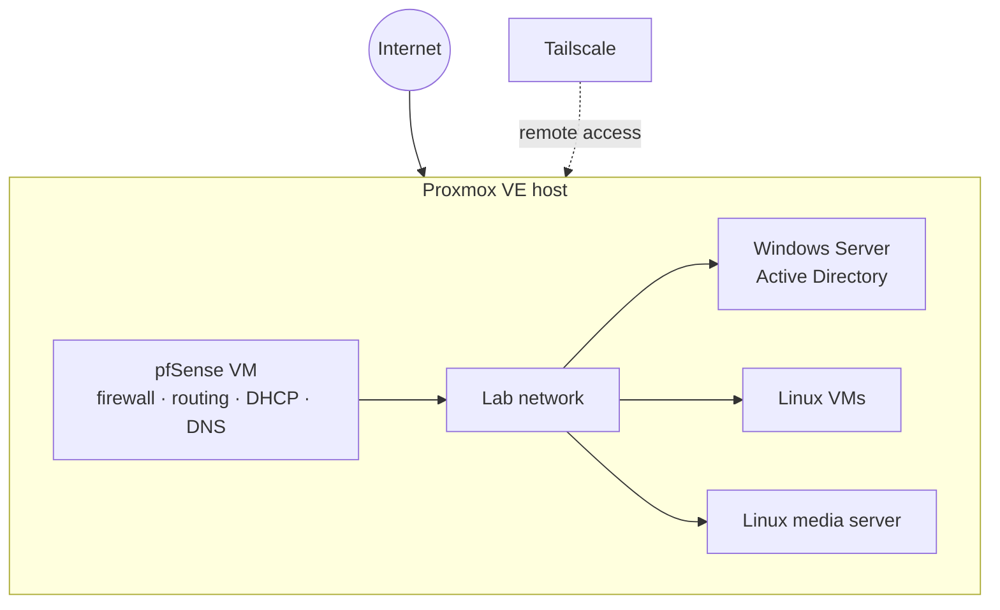

# Homelab

A personal lab built on a **Proxmox VE** virtualization server, used to practice systems administration and networking hands-on. Running since April 2026.

> Addresses, hostnames, domain names, and credentials are intentionally left out of this repo.

## What's in it

| Area | What I run / practice |
|---|---|
| Virtualization | Proxmox VE hosting Windows and Linux VMs, including GPU passthrough |
| Networking & firewall | pfSense for firewall rules, routing, and network segmentation |
| Directory services | Windows Server with Active Directory in a lab domain |
| Linux | Linux VMs for general administration practice, plus a Linux media server |
| Core network services | DNS and DHCP |
| Remote access | Tailscale for secure access to the lab from outside the network |

## Layout

pfSense runs as a VM on the Proxmox host and routes traffic for the lab network.

## Related

- [My GitHub profile](https://github.com/Ismael0550)
- [LinkedIn](https://www.linkedin.com/in/ismael-saldivar-74a75b112/)
