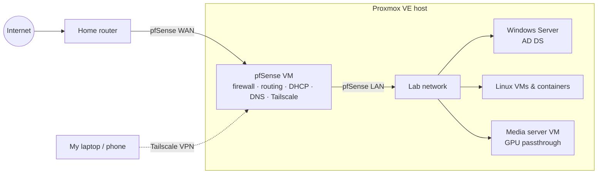

# Homelab

A single-node **Proxmox VE** lab I've run since April 2026 to practice Linux administration, networking, and Windows infrastructure hands-on.

> Public IPs, internal addresses, hostnames, domain names, and credentials are intentionally left out of this repo.

## Why I built it

At work I support Windows imaging, Active Directory, and Linux and Windows troubleshooting. The lab lets me go further than the job does: designing the network myself, running my own firewall and domain, and breaking things without affecting anyone else.

## Architecture

The lab sits **behind my home router**, so pfSense's WAN side is on the home network and everything in the lab is on a separate network behind pfSense (double NAT). This is a single-host learning lab, not a high-availability setup.

## Components

| Component | Role in the lab |
|---|---|
| **Proxmox VE** | Hypervisor for every guest: Linux and Windows VMs and Linux containers, connected through Proxmox network bridges and virtual NICs |
| **pfSense (VM)** | Router and firewall for the lab network. Firewall rules, routing, DHCP, and DNS |
| **Tailscale (on pfSense)** | VPN for remote access to the lab without opening ports on the home router |
| **Windows Server** | Active Directory Domain Services, for domain and AD administration practice |
| **Linux VMs & containers** | Linux server administration: systemd services, logs, permissions, packages, SSH |
| **Media server VM** | Linux media server with a GPU passed through from the host |

## What I'm practicing

- **Networking:** firewall policy, routing, DHCP and DNS on pfSense, double NAT, and VPN remote access
- **Virtualization:** VMs vs. containers, Proxmox bridges and virtual NICs, and PCIe/GPU passthrough
- **Windows infrastructure:** standing up AD DS and running a domain
- **Linux administration:** service management, logs, permissions, SSH, and troubleshooting on server distros

## Related

- [GitHub profile](https://github.com/Ismael0550)
- [LinkedIn](https://www.linkedin.com/in/ismael-saldivar-74a75b112/)
